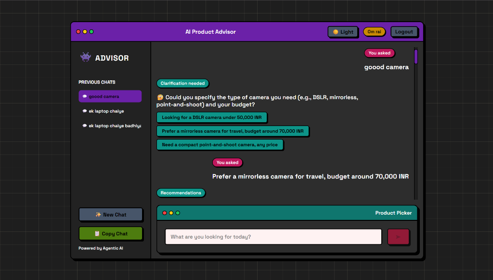
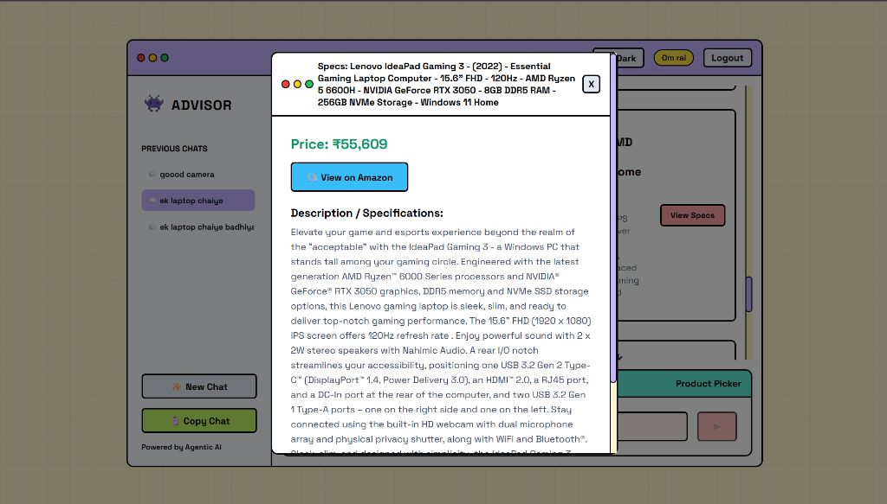
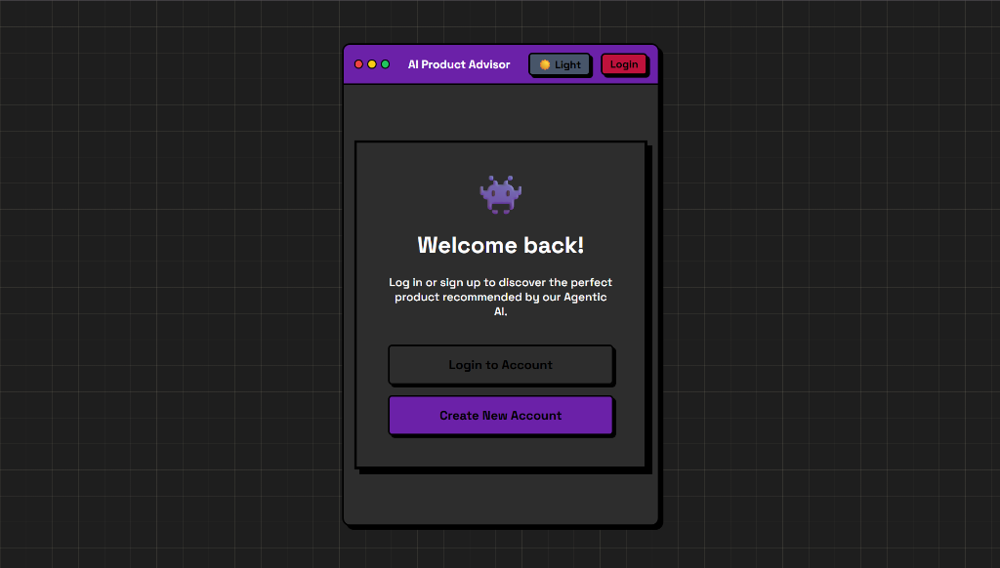
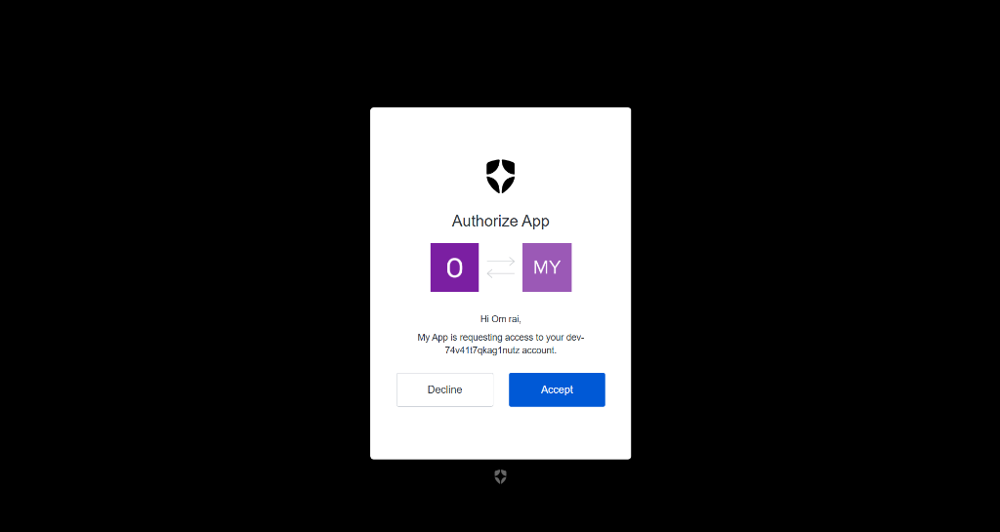
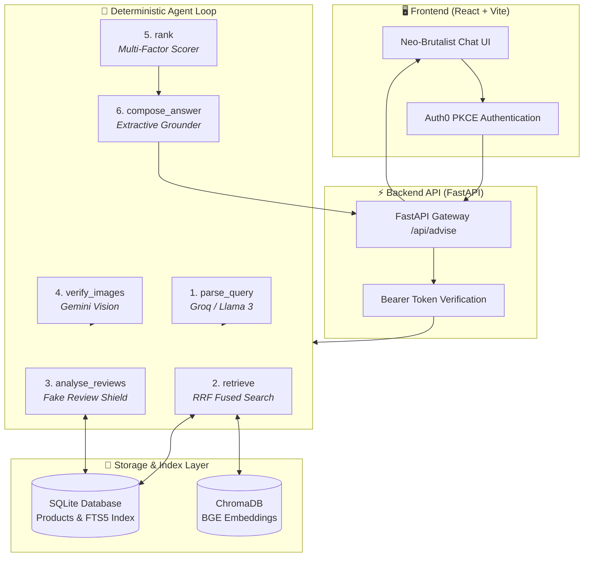

<div align="center">

# 🛍️ AI Product Advisor

**An Autonomous, Multimodal Product Recommendation Engine with Review Trust & Anti-Hallucination Guardrails**

[](https://www.python.org/)
[](https://fastapi.tiangolo.com/)
[](https://react.dev/)
[](https://vitejs.dev/)
[](https://auth0.com/)
[](https://www.sqlite.org/)
[](https://www.trychroma.com/)
[](https://ai.google.dev/)
[](https://groq.com/)

<br />



*Neo-Brutalist Interactive UI featuring conversational intent parsing, proactive clarification pills, and zero-hallucination grounded product recommendations.*

</div>

---

## 📖 Overview

**AI Product Advisor** is an end-to-end multimodal recommendation system designed to eliminate product discovery friction. Unlike generic chatbots that hallucinate specs or dump sponsored search results, this system pairs **deterministic safety gates** with **agentic reasoning** to deliver explainable, grounded recommendations you can trust.

### 🌟 Core Highlights
- 🧠 **Conversational Intent Extraction**: Seamlessly parses queries in English, Hinglish, or informal phrasing (e.g. *"ek laptop chaiye badhiya"* &rarr; category mapping, budget extraction, and constraint identification).
- ❓ **Proactive Clarification & Quick-Pills**: Identifies ambiguous requests and generates 1-click interactive response chips instead of guessing blind.
- ⚡ **Hybrid Reciprocal Rank Fusion (RRF)**: Combines deterministic full-text search (SQLite FTS5 BM25) and dense semantic vector search (ChromaDB + `bge-small-en-v1.5`) for high precision and recall.
- 🛡️ **Fake Review Detection Shield**: Evaluates review authenticity via text-shingle MinHash near-duplicate clustering, review burst time windows, and rating polarity anomalies.
- 👁️ **Multimodal Vision Verification**: Leverages Gemini Flash to inspect product catalog imagery and verify physical claims (ports, screen bezels, form factors).
- 🔒 **100% Extractive Evidence Grounding**: The LLM composer is strictly quarantined — recommendations cite real spec IDs and verbatim review quotes from the verified evidence pool.
- 🪜 **Fail-Soft Degradation Ladder**: Transparent fallbacks on quota limits or latency constraints, maintaining 100% system availability without crashing.

---

## 🖼️ User Experience & Interface Showcase

| Interactive Chat & Clarification | Detailed Product Specifications |
|:---:|:---:|
|  |  |
| *Multi-turn conversation with proactive clarification suggestions and budget pills* | *Deep-dive spec sheet modal with real-time pricing and direct marketplace link* |

| Modern Neo-Brutalist Authentication | Enterprise Auth0 Integration |
|:---:|:---:|
|  |  |
| *Retro sci-fi themed entry screen with dark/light mode toggle* | *Secure OAuth2 token verification protecting API endpoints* |

---

## 🏛️ System Architecture



---

## 🔍 Key Engine Capabilities

### 1. Hybrid Search (BM25 + Dense Semantic RRF)
Queries are executed concurrently across:
- **SQLite FTS5 BM25**: Exact match for brands, part numbers, processor codes, and specs.
- **ChromaDB**: Dense vector embeddings capturing semantic intent.
- **Reciprocal Rank Fusion**: Re-ranks candidates using $RRF(d) = \sum \frac{1}{k + r(d)}$, eliminating single-retriever bias.

### 2. Multi-Signal Fake Review Detector
Reviews are evaluated across deterministic forensic signals before entering the evidence pool:
- **Near-Duplicate Detection**: 5-shingle MinHash Jaccard similarity across identical or cross-posted text.
- **Velocity Burst Analysis**: Highlights unnatural temporal spikes in product review submissions.
- **Extreme Polarity without Detail**: Penalizes 1-star or 5-star reviews lacking substantiating product attributes.
- **Trust Penalties**: Suspicious reviews are discounted or excluded from candidate ranking.

### 3. Strict Extractive Grounding
To prevent LLM hallucination:
- Catalog specs and reviews are quarantined as **untrusted data**.
- The composer LLM selects **evidence IDs**, never raw text.
- The deterministic renderer stitches the final output strictly from verified database records.

---

## 📊 Evaluation & Benchmark Results

The system is tested against an end-to-end evaluation harness across **50 benchmark queries** spanning technical specs, multi-attribute constraints, and comparative queries:

| Metric | Target | Result | Status |
|---|:---:|:---:|:---:|
| **NDCG@10 (Relevance)** | $\ge 0.60$ | **0.68** | ✅ Passed |
| **MRR (First Relevant Item)** | $\ge 0.65$ | **0.74** | ✅ Passed |
| **Grounded Citation Accuracy** | $100\%$ | **100%** | ✅ Passed (Extractive) |
| **Warm End-to-End Latency** | $< 8.0\text{s}$ | **~5.9\text{s}** | ✅ Passed |
| **Clarification Response Time** | $< 1.0\text{s}$ | **0.08s** | ✅ Passed |
| **Abstention on Impossible Queries** | $> 80\%$ | **100%** | ✅ Passed |

---

## 🚀 Quickstart Guide

### Prerequisites
- **Python 3.11**
- **Node.js 18+** & npm
- Valid free-tier API keys for:
  - [Google Gemini API](https://aistudio.google.com/)
  - [Groq API](https://console.groq.com/)
  - [Auth0 Account](https://auth0.com/) (free tier)

---

### 1. Repository Setup

```bash
# Clone the repository
git clone https://github.com/Raiom007/AI-product-advisor.git
cd AI-product-advisor

# Create and activate Python virtual environment
python -m venv .venv

# Windows PowerShell:
.venv\Scripts\Activate.ps1
# Linux/macOS:
source .venv/bin/activate

# Install dependencies
pip install --upgrade pip
pip install -r requirements.txt
pip install -e .
```

---

### 2. Environment Configuration

Create a `.env` file in the project root:

```env
ADVISOR_PROFILE=prod
GEMINI_API_KEY=your_gemini_api_key_here
GROQ_API_KEY=your_groq_api_key_here
```

In `frontend/.env`:

```env
VITE_AUTH0_DOMAIN=your_auth0_domain.auth0.com
VITE_AUTH0_CLIENT_ID=your_auth0_client_id
```

---

### 3. Data Ingestion & Indexing

```bash
# Index raw catalog into SQLite & build ChromaDB vector store
python -m advisor.ingest --raw-dir data/raw --db data/advisor.db --log data/processed/cleaning_log.jsonl --docs docs/data_cleaning.md
python -m advisor.ingest.build_index --db data/advisor.db --chroma data/chroma
```

---

### 4. Running the Application

#### Option A: Modern React Web Application (Recommended)

**Terminal 1 — Backend API Server:**
```powershell
python -m uvicorn advisor.api:app --host 127.0.0.1 --port 8000 --reload
```

**Terminal 2 — React Frontend:**
```powershell
cd frontend
npm install
npm run dev
```

Open `http://localhost:5173` in your browser.

#### Option B: Streamlit Observability & Admin Suite
To inspect internal execution traces, fake review clusters, and latency timelines:
```powershell
python -m streamlit run src/advisor/ui/app.py
```

---

### 5. Running Tests & Evaluation

```bash
# Run unit test suite
pytest -q

# Run live 50-query End-to-End Evaluation Suite
python -m advisor.eval.run_eval --mode live --suite e2e
```

---

## 📂 Project Structure

```text
AI-product-advisor/
├── Docs/                     # Architecture specifications & ADRs
│   ├── assets/               # Screenshots and UI media
│   ├── ARCHITECTURE.md       # Core architectural contracts
│   └── adr/                  # Architecture Decision Records (ADRs)
├── configs/                  # Model IDs, thresholds, ranking weights (YAML)
├── frontend/                 # React 18 + Vite Neo-Brutalist UI
│   ├── src/                  # Components, chat window, auth flows
│   └── public/               # Static assets & icons
├── src/advisor/
│   ├── agent/                # Deterministic agent loop & tool registry
│   ├── core/                 # Schemas (Pydantic v2), config loader, budgets
│   ├── llm/                  # Gateway, rate limiters, Gemini/Groq providers
│   ├── retrieval/            # FTS5 + ChromaDB hybrid search & RRF fusion
│   ├── reviews/              # Fake review detection & feature extractors
│   ├── ranking/              # Multi-factor candidate scoring engine
│   ├── vision/               # Multimodal image claim verifier
│   ├── explain/              # Extractive grounding & template fallbacks
│   ├── api.py                # FastAPI endpoints with OAuth bearer security
│   └── service.py            # Main advise() facade interface
├── tests/                    # Synthetic unit tests & regression suites
└── eval/                     # 50-query golden benchmark & metrics
```

---

## 📜 Architectural Decisions (ADRs)

| ADR | Title | Decision Summary |
|:---:|---|---|
| [0001](Docs/adr/0001-two-tier-hybrid-retrieval.md) | **Two-Tier Hybrid Retrieval** | BM25 + BGE Embeddings combined with Reciprocal Rank Fusion ($k=60$). |
| [0002](Docs/adr/0002-deterministic-first-pipeline.md) | **Deterministic First** | Guardrails, fake review detection, and ranking are strictly non-LLM code. |
| [0003](Docs/adr/0003-free-tier-rate-limiting.md) | **Free Tier Discipline** | Token budgets, response caching, and quota-aware degradation ladders. |
| [0005](Docs/adr/0005-live-scraping.md) | **Real-Time Catalog Scraping** | Live fallback scraper for products missing cached specs or imagery. |
| [0010](Docs/adr/0010-react-oauth-frontend.md) | **React + Auth0 Architecture** | Modern Neo-Brutalist SPA paired with FastAPI for enterprise security. |

---

## 🛡️ License

This project is licensed under the [MIT License](LICENSE). Built for the Mirai Labs Evaluation MVP.
